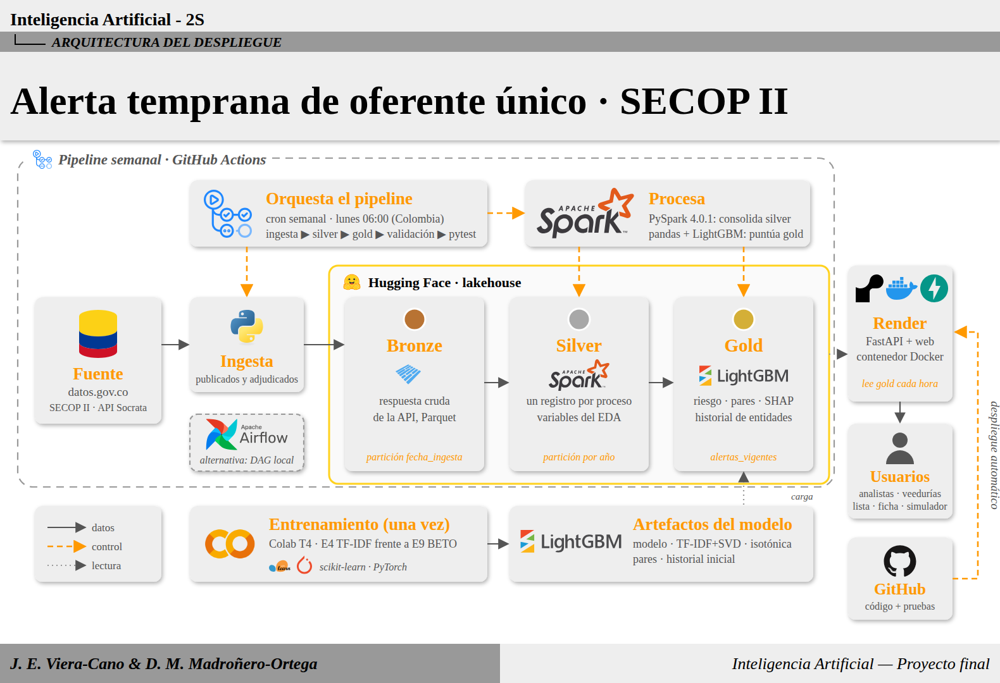

# Alerta temprana de oferente único — despliegue

Sistema que prioriza, cada día, los procesos de contratación pública de SECOP II que siguen recibiendo ofertas
según su probabilidad de recibir **una sola oferta**, con la explicación de cada alerta.
*Priorizar, no señalar:* el riesgo de oferente único no es evidencia de corrupción.

Curso Inteligencia Artificial (535212), UAO, 2026-2S · Dilian Mayerly Madroñero Ortega y Juan Estevan Viera Cano.

- **Aplicación (Render):** https://alerta-oferente-unico.onrender.com
- **Lakehouse (bronze, gold, estado):** https://huggingface.co/datasets/JuanEstevan-DataEng/secop-oferente-unico-lakehouse

## Arquitectura



| Componente | Archivo | Qué hace |
|---|---|---|
| Entrenamiento | `entregable_3_IA.ipynb` (Colab, GPU T4) | Selecciona el modelo (E4) y exporta `artefactos/` |
| Bronze | `pipeline/ingesta.py` | Consulta procesos publicados y adjudicados de los últimos 14 días |
| Silver | `pipeline/medallon_spark.py` | PySpark: deduplicación, última versión, variables derivadas |
| Estado | `oferente_unico/puntuacion.py` | Suma al historial de cada entidad los adjudicados nuevos (sin reentrenar) |
| Gold | `oferente_unico/puntuacion.py` | Puntaje, calibración, riesgo de pares, factores SHAP (TreeSHAP nativo de LightGBM) |
| Orquestación | `pipeline/ejecutar_semana.py`, `.github/workflows/pipeline_semanal.yml`, `pipeline/dags/` | Ejecución diaria (GitHub Actions o Airflow) |
| Lakehouse remoto | `pipeline/sincronizar.py` | Repositorio de datos de Hugging Face como almacenamiento de objetos |
| Hosting | `Dockerfile`, `render.yaml` | Render (Docker, plan gratuito): descarga gold y estado al arrancar y cada hora |
| Aplicación | `app/` | API FastAPI y página web: lista, ficha, evaluación 2026, simulador |

## Uso local

```bash
uv venv .venv --python 3.12 && uv pip install --python .venv/bin/python -r requirements-pipeline.txt
# Opción A: traer el lakehouse publicado
HF_DATASET=JuanEstevan-DataEng/secop-oferente-unico-lakehouse .venv/bin/python pipeline/sincronizar.py descargar --capas bronze gold estado
# Opción B: construirlo desde cero (recupera desde el corte de los datos de entrenamiento)
.venv/bin/python pipeline/ejecutar_semana.py --desde 2026-09-17
.venv/bin/python pipeline/ejecutar_semana.py                      # días siguientes
.venv/bin/python pipeline/validacion_prospectiva.py
.venv/bin/uvicorn app.main:app --port 8000                        # http://localhost:8000
```

Con Docker: `docker compose up -d app` (≈ 330–430 MB de RAM; cabe en el plan gratuito de Render, 512 MB) y `docker compose --profile pipeline run --rm pipeline`.

## Verificación

| Prueba | Resultado |
|---|---|
| `tests/verificar_contra_notebook.py`: el paquete reproduce el notebook en los 40 589 procesos de 2026 | 100 % en riesgo, pares, alertas (umbral del modelo) y factores |
| `tests/test_silver_spark.py`: silver en Spark igual a la versión pandas | 100 % en 16 columnas |
| `tests/test_api.py`: API web (orden, nuevos, búsqueda, municipio, alerta = riesgo mostrado ≥ umbral) | 18 pruebas |
| `pipeline/validacion_prospectiva.py`: semanas posteriores al entrenamiento | PR-AUC 0,783 en 7 210 procesos; precisión de las 50 primeras alertas 0,86–0,96 |

## Cambios tras la validación con la usuaria (26-nov-2026)

| Hallazgo | Cambio |
|---|---|
| Al buscar «Cali» aparecían Bugalagrande («**cali**dad») y Buenaventura («lo**cali**zado») | El buscador encuentra palabras completas y no distingue tildes; filtro de **municipio** (texto libre con sugerencias del departamento) |
| No entendía qué eran los «pares» | La columna se llama «Lo normal en similares» y el orden por defecto, «Más fuera de lo normal» |
| Creía que el riesgo sube con los días hasta llegar a 100 | Aviso y ficha: el riesgo no es una cuenta regresiva |
| Pidió que la página explique para qué sirve | Guía rápida de 8 pasos que oscurece la página e ilumina cada herramienta (botón «Guía rápida»; `?guia=0` la desactiva y `?guia=N` abre el paso N) |
| Procesos con el mismo riesgo mostrado (65,6 %) quedaban unos con alerta y otros sin ella | La alerta usa el umbral de alta precisión llevado a la escala calibrada: alerta = riesgo mostrado ≥ 65,6 % |

## Mantenimiento

- **Cada día:** ingesta, actualización del historial y nueva lista con la marca «nuevo» para los procesos que entran hoy (automático). La ejecución era semanal, pero el 38 % de la lista semanal ya había cerrado la recepción de ofertas.
- **Cada mes:** revisar la validación prospectiva; si la calibración se desvía (probabilidad media frente a tasa real), reajustar el calibrador con las semanas cuyo resultado ya se conoce.
- **Cada año:** reentrenar en Colab con el año completo más reciente y reemplazar `artefactos/` (mismas versiones de scikit-learn y LightGBM que registre `metadatos.json`).
