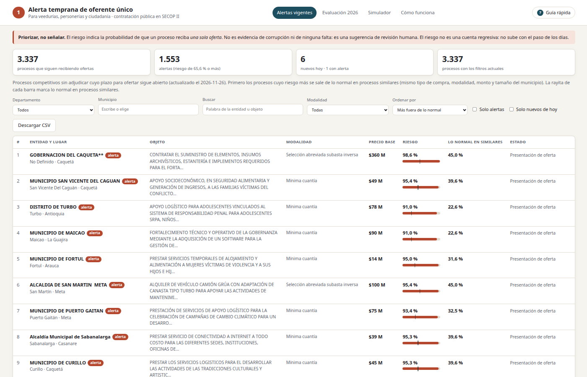
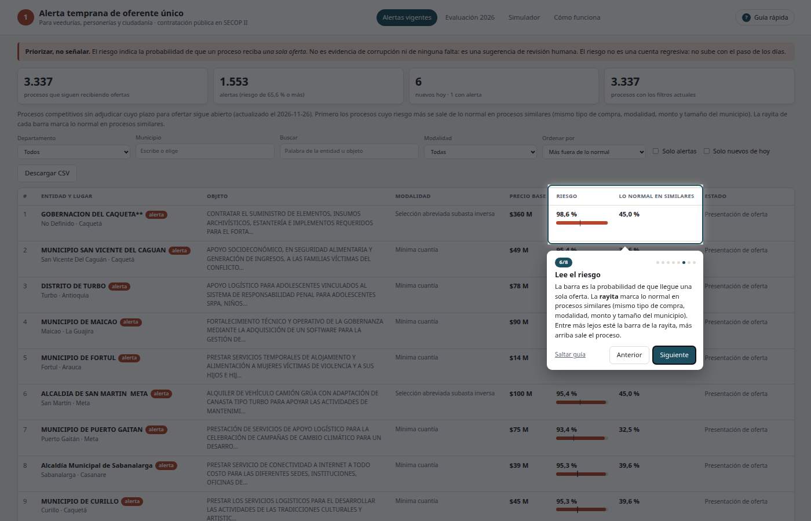

# Alerta temprana de oferente único en SECOP II

Sistema que, **cada día**, revisa los procesos de contratación pública de Colombia que todavía reciben ofertas en
SECOP II y los ordena según qué tan probable es que les llegue **una sola oferta**, es decir, que no haya
competencia. Cada proceso viene con la explicación de por qué salió con riesgo alto y el enlace para revisarlo.

> **Priorizar, no señalar.** Un proceso con una sola oferta **no** es evidencia de corrupción: puede deberse a un
> mercado local pequeño o a un objeto muy especializado. El sistema solo sugiere **por dónde empezar a revisar**,
> y la revisión la hace una persona.

| | |
|---|---|
| **Aplicación web** | https://alerta-oferente-unico.onrender.com (plan gratuito: si estuvo inactiva, la primera carga tarda unos 30 s) |
| **Lakehouse (datos y resultados diarios)** | https://huggingface.co/datasets/JuanEstevan-DataEng/secop-oferente-unico-lakehouse |
| **Artículo del proyecto** | [`docs/articulo_entregable3.pdf`](docs/articulo_entregable3.pdf) |
| **Notebook de entrenamiento** | [`notebooks/entregable_3_IA.ipynb`](notebooks/entregable_3_IA.ipynb) (Google Colab, GPU T4) |

Proyecto final del curso **Inteligencia Artificial (535212)**, Universidad Autónoma de Occidente, 2026-2S.
Equipo: **Dilian Mayerly Madroñero Ortega** y **Juan Estevan Viera Cano**. Docentes: José Luis Paniagua Jaramillo y
Jesús Alfonso López Sotelo.

---

## Contenido

1. [El problema](#1-el-problema)
2. [Qué ve el usuario](#2-qué-ve-el-usuario)
3. [El modelo](#3-el-modelo)
4. [De la probabilidad a la lista](#4-de-la-probabilidad-a-la-lista)
5. [Arquitectura del despliegue](#5-arquitectura-del-despliegue)
6. [Estructura del repositorio](#6-estructura-del-repositorio)
7. [Cómo ejecutarlo](#7-cómo-ejecutarlo)
8. [API](#8-api)
9. [Verificación y evaluación](#9-verificación-y-evaluación)
10. [Validación con la usuaria](#10-validación-con-la-usuaria)
11. [Mantenimiento](#11-mantenimiento)
12. [Limitaciones](#12-limitaciones)

---

## 1. El problema

Cuando una entidad pública compra algo (alimentos, una obra, transporte), lo publica en **SECOP II** para que
cualquier empresa pueda ofertar. Si llega **una sola oferta**, no hubo competencia, y sin competencia el Estado
suele pagar más: en Europa, los contratos con un solo oferente resultaron entre 9 % y 9,6 % más caros. En SECOP II,
el **37,3 %** de los procesos competitivos adjudicados recibió una única oferta, y en 2026 la tasa subió a **45,6 %**.

Las veedurías ciudadanas, las personerías, las contralorías y las oficinas de control interno no pueden revisar
todos los procesos. Por eso la pregunta del proyecto es:

> ¿Es posible estimar, **el día en que se publica un proceso**, la probabilidad de que reciba un solo oferente,
> usando únicamente la información disponible en ese momento?

La respuesta llega cuando todavía se puede actuar, porque el plazo para ofertar sigue abierto. Los antecedentes
colombianos usan información posterior a la firma del contrato.

| El sistema estima | El sistema **no** estima |
|---|---|
| La probabilidad de que un proceso reciba una sola oferta, con la información del día de su publicación | Si un proceso es corrupto |
| Un orden de prioridad para la revisión humana | Si una entidad o un funcionario incurrió en una falta |
| Los factores asociados a una menor competencia esperada | Si hubo direccionamiento, fraude o ilegalidad |

---

## 2. Qué ve el usuario



La pestaña **Alertas vigentes** muestra los procesos competitivos sin adjudicar cuyo plazo para ofertar sigue
abierto. Se actualiza cada día; el 26 de noviembre de 2026 eran 3.337 procesos y 1.553 alertas.

| Elemento | Qué significa |
|---|---|
| **Riesgo** (barra) | Probabilidad calibrada de que el proceso reciba una sola oferta. Se calcula con lo que se sabía al publicarse el proceso y con el historial de la entidad; **no sube con el paso de los días** |
| **Lo normal en similares** (rayita sobre la barra) | Porcentaje de procesos parecidos (mismo tipo de compra, modalidad, rango de monto y tamaño del municipio) que históricamente recibieron una sola oferta |
| **Orden por defecto: «Más fuera de lo normal»** | Primero los procesos cuyo riesgo más se aleja de lo normal para su tipo. Así la lista no se llena de municipios pequeños, donde la oferta única es frecuente porque hay pocos proveedores |
| **Etiqueta «alerta»** | Riesgo de **65,6 % o más** (umbral de alta precisión: en 2025, al menos el 80 % de las alertas acertó) |
| **Etiqueta «nuevo»** y filtro **«Solo nuevos de hoy»** | Procesos que entraron a la lista desde la ejecución anterior |
| **Otros órdenes** | Por riesgo, por precio base o por **monto en juego** (riesgo × precio base), cuando importa más dónde hay más dinero |
| **Filtros** | Departamento, municipio (texto libre con sugerencias), modalidad y búsqueda por palabra completa sin tildes |
| **Ficha del proceso** | Clic en una fila: factores que elevan el riesgo (SHAP), términos clave del objeto, fechas y enlace a SECOP II |
| **Descargar CSV** | La lista con los filtros elegidos |

Las otras pestañas son **Evaluación 2026** (procesos de 2026, que el modelo no vio, con el número real de ofertas
que recibieron), **Simulador** (puntúa un proceso hipotético en vivo) y **Cómo funciona** (arquitectura y métricas).

### Guía rápida

La primera vez que alguien entra, una guía de **8 pasos** oscurece la página, ilumina una herramienta a la vez y la
explica en un globo con contador (1/8, 2/8…). Se vuelve a abrir con el botón **«Guía rápida»**. En la URL,
`?guia=0` la desactiva (útil en demostraciones) y `?guia=N` abre el paso N.



---

## 3. El modelo

### Datos

- **Fuente:** API Socrata de datos.gov.co, *SECOP II – Procesos de Contratación* (`p6dx-8zbt`), complementada con
  *Proponentes por Proceso* (`hgi6-6wh3`) para validar la etiqueta.
- **Población:** siete modalidades competitivas: licitación pública, licitación de obra pública, selección
  abreviada de menor cuantía, subasta inversa, concurso de méritos abierto, mínima cuantía y acuerdo marco.
- **Etiqueta:** `oferente_unico = 1` si el proceso adjudicado recibió exactamente una oferta (99,8 % de acuerdo con
  el conjunto de proponentes en una muestra de 1.500 procesos).
- **Partición cronológica**, para evaluar como en el uso real: entrenamiento 2017–2024 (291.053 procesos),
  validación 2025 (68.430, para elegir modelo, umbral y calibración) y prueba 2026 (40.589, usada **una sola vez**).

### Variables (119, todas conocidas el día de la publicación)

| Grupo | Variables |
|---|---|
| Categóricas | modalidad, tipo de contrato, orden de la entidad, segmento UNSPSC, departamento |
| Frecuencias | de la entidad, del código UNSPSC y del municipio |
| Numéricas | precio base (log), duración, días para ofertar, número de lotes, mes, año |
| **Historial de la entidad** (sin fuga) | procesos previos y tasa previa de oferente único de la entidad, y de la entidad en ese segmento; días desde su último proceso. Solo cuentan procesos **adjudicados antes** de la publicación |
| **Texto del objeto** | TF-IDF de palabras y bigramas (100.000 términos) reducido con SVD a 100 componentes |

Se excluyó `proveedores_invitados` porque se conoce después de publicar el proceso y producía una fuga de
información.

### Experimentos y elección

Los experimentos se identifican con códigos E0–E9 y van de menor a mayor complejidad:

| Código | Qué es | PR-AUC 2026 |
|---|---|---|
| E0 | Regla: tasa histórica del tipo de compra en el departamento | 0,683 |
| E1 | Regresión logística (rejilla L1/L2 × C) | 0,708 |
| E2 | LightGBM: muchos árboles de decisión que se corrigen entre sí | 0,778 |
| E3 | LightGBM + historial de la entidad (modelo del entregable II) | 0,798 |
| **E4** | **E3 + texto del objeto con TF-IDF: modelo final** | **0,806** |
| E9 | E3 + texto con BETO (BERT en español, congelado) | 0,804 |
| E4 + E9 | Ambas representaciones del texto | 0,808 |
| E5 | No es otro modelo: reordena la lista frente a procesos similares (sección 4) | — |
| E6 · E7 | Red neuronal MLP y kNN: no superan a E3 | 0,793 · 0,756 |
| E8 | Autoencoder (no supervisado): detecta rareza, no oferta única | 0,453 |

El azar da una PR-AUC de 0,456 (la prevalencia de 2026). **Regla de selección fijada antes de ver los resultados:**
gana la mayor PR-AUC en 2025 y, si la diferencia con un modelo más simple es menor que 0,005, gana el más simple.
Por eso se eligió **E4 (TF-IDF)** y no BETO: rinde igual y permite desplegar sin GPU ni un modelo de 440 MB. Frente
a E3, el texto mejora de forma pequeña pero significativa: +0,009 de PR-AUC (IC 95 %: +0,007 a +0,011) y McNemar
con p = 6,3·10⁻⁴.

**Hiperparámetros.** La configuración de LightGBM (31 hojas, mínimo 50 procesos por hoja, tasa de aprendizaje 0,05,
submuestreo de filas y columnas de 0,8) se eligió con validación cruzada temporal en el entregable II: tres
configuraciones validadas en 2022, 2023 y 2024. El número de árboles lo fija el *early stopping* (100 rondas sobre
la PR-AUC de 2025). El desbalance se trata con un peso de 1,883 para la clase positiva, sin datos sintéticos.

### Resultados del modelo final en 2026

| Métrica | Valor |
|---|---|
| PR-AUC (azar 0,456) | **0,806** |
| ROC-AUC | 0,843 |
| Precisión en el 1 % superior de la lista | 0,978 |
| Umbral de alta precisión (el que usa el producto) | precisión 0,808 · recall 0,561 |
| Umbral equilibrado (máx. F1) | precisión 0,702 · recall 0,822 |

El producto usa el umbral de **alta precisión**: un falso positivo gasta la capacidad de revisión y apunta sin razón
a una entidad, mientras que un falso negativo es un proceso que no se revisa, lo que de todos modos ocurre con la
mayoría.

---

## 4. De la probabilidad a la lista

| Paso | Qué es | Dónde se usa |
|---|---|---|
| 1. Puntaje de LightGBM | Probabilidad inflada por el peso de la clase positiva | Factores SHAP |
| 2. Probabilidad corregida | `logit(puntaje) − ln(1,883)` | Orden de la lista |
| 3. **Riesgo** (probabilidad calibrada) | Regresión isotónica ajustada en 2025, para que «70 %» signifique que de cada 100 procesos así, unos 70 reciben una oferta. Se muestra recortada a [1 %, 99 %] | **Lo que ve el usuario** y la **alerta** (≥ 65,6 %) |
| 4. **Lo normal en similares** (riesgo de pares) | Tasa histórica de oferente único del grupo de procesos con el mismo segmento UNSPSC, modalidad, quintil de cuantía y quintil de tamaño del mercado municipal. Se suaviza hacia el grupo más amplio cuando hay pocos casos (m = 50) | Rayita de la barra |
| 5. **Prioridad** | `logit(probabilidad corregida) − logit(lo normal)`: cuántas veces mayores son los momios del proceso que los de procesos similares | Orden por defecto |

**Por qué se compara con procesos similares (E5).** Si la lista se ordenara solo por riesgo, el 20 % de municipios
con menor mercado se quedaría con el 56 % de las alertas, siendo el 33 % de los procesos. Comparar con lo normal
para cada tipo de proceso baja la brecha de sobrerrepresentación de 1,54 a 1,24, a cambio de que la precisión del
1 % superior pase de 0,978 a 0,899. La regla para adoptarlo se fijó en validación.

**Por qué el orden usa la probabilidad corregida y no la calibrada.** La isotónica es escalonada: hay unos 94
valores distintos para miles de procesos, y ordenar con ellos produciría cientos de empates. La **alerta**, en
cambio, sí se define sobre el número que ve el usuario: el umbral de alta precisión (0,571 en la escala corregida)
equivale a **65,6 %** en la escala calibrada, así que **tiene alerta todo proceso con riesgo mostrado ≥ 65,6 %**.

**Explicación de cada alerta.** Valores SHAP exactos de LightGBM (TreeSHAP nativo); las 100 componentes del texto se
suman en un solo factor, «texto del objeto», y se muestran los cinco términos con más peso del objeto. Los factores
más importantes son la tasa previa de oferente único de la entidad (17 %), el texto del objeto (12,5 %) y el
segmento UNSPSC (11 %). Son asociaciones aprendidas, no causas.

---

## 5. Arquitectura del despliegue


El entrenamiento se hace **una vez** en Google Colab y exporta sus artefactos (`artefactos/`). El resto corre solo,
**cada día**, sin servidor propio:

| Componente | Archivo | Qué hace |
|---|---|---|
| Entrenamiento | `notebooks/entregable_3_IA.ipynb` (Colab, GPU T4) | Selecciona el modelo (E4) y exporta `artefactos/` |
| Bronze | `pipeline/ingesta.py` | Consulta en la API los procesos publicados y adjudicados de los últimos 14 días; un archivo Parquet por consulta, particionado por fecha de ingesta |
| Silver | `pipeline/medallon_spark.py` | PySpark: deduplicación, última versión de cada proceso y variables del análisis exploratorio (`oferente_unico/transformaciones.py` es la versión de referencia en pandas) |
| Estado | `oferente_unico/puntuacion.py` | Suma al historial de cada entidad los procesos recién adjudicados (sin reentrenar) |
| Gold | `oferente_unico/puntuacion.py` | Puntaje, calibración, lo normal en similares, prioridad, alerta y factores SHAP de los procesos con plazo abierto; marca de nuevos |
| Orquestación | `pipeline/ejecutar_semana.py`, `.github/workflows/pipeline_semanal.yml`, `pipeline/dags/` | GitHub Actions a las 06:00 de Colombia; un DAG de Airflow equivalente como alternativa. Los nombres de archivo son de cuando la ejecución era semanal |
| Lakehouse remoto | `pipeline/sincronizar.py` | Dataset de Hugging Face como almacenamiento de objetos, en el papel de MinIO/S3 |
| Hosting | `Dockerfile`, `render.yaml` | Render (Docker, plan gratuito de 512 MB): descarga gold y estado al arrancar y cada hora |
| Aplicación | `app/` | API FastAPI y página web sin dependencias externas |

**Por qué diario.** La primera versión corría cada lunes, una frecuencia elegida sin criterio explícito. Al
revisarla se encontró que el 38 % de la lista semanal (y el 49 % de las alertas) ya había cerrado la recepción de
ofertas: en mínima cuantía la mediana es de 5 días para ofertar. En la validación, la usuaria pidió además la
actualización diaria sin que se le sugiriera.

**Por qué estas herramientas.** Spark donde el volumen lo justifica (silver recorre toda la historia) y servicios
gestionados gratuitos para el resto, de modo que el sistema funcione aunque el computador de los autores esté
apagado. Elegir TF-IDF en lugar de BETO permitió que la aplicación quepa en 512 MB sin GPU.

---

## 6. Estructura del repositorio

```
.
├── app/
│   ├── main.py                  API FastAPI: lista, filtros, ficha, descarga, simulador
│   └── static/                  Página web (HTML, CSS y JS sin dependencias)
│       ├── app.js               Lista, ficha, simulador y pestaña «Cómo funciona»
│       └── guia.js              Guía rápida de 8 pasos
├── oferente_unico/
│   ├── transformaciones.py      Silver en pandas (referencia): limpieza y variables
│   └── puntuacion.py            Clase Puntuador: estado, puntaje, calibración, pares, alerta y SHAP
├── pipeline/
│   ├── ingesta.py               Bronze: consultas a la API de datos.gov.co
│   ├── medallon_spark.py        Silver con PySpark
│   ├── ejecutar_semana.py       Orquesta bronze → silver → estado → gold (ejecución diaria)
│   ├── validacion_prospectiva.py  Simula ejecuciones pasadas y las compara con lo que ocurrió
│   ├── sincronizar.py           Descarga y sube capas del lakehouse en Hugging Face
│   └── dags/                    DAG de Airflow alternativo
├── artefactos/                  Modelo LightGBM, TF-IDF + SVD, calibrador, historiales, pares y metadatos.json
├── tests/                       pytest de la API, del pipeline y de Spark; verificación contra el notebook
├── notebooks/                   Notebook de entrenamiento (Colab)
├── docs/                        Diagrama de arquitectura, capturas y artículo en PDF
├── .github/workflows/           Ejecución diaria en GitHub Actions
├── Dockerfile · render.yaml     Imagen de la aplicación y despliegue en Render
├── docker-compose.yml           Aplicación y pipeline en local
└── requirements-app.txt · requirements-pipeline.txt
```

La carpeta `lakehouse/` (bronze, silver, gold y estado) no se versiona: se descarga del dataset de Hugging Face o se
construye con el pipeline.

---

## 7. Cómo ejecutarlo

Requisitos: Python 3.12. Para la capa silver con Spark, además Java 21. Las versiones de scikit-learn (1.6.1) y
LightGBM (4.6.0) están fijadas porque los artefactos `.joblib` no son portables entre versiones.

```bash
uv venv .venv --python 3.12 && uv pip install --python .venv/bin/python -r requirements-pipeline.txt

# Opción A: traer el lakehouse publicado
HF_DATASET=JuanEstevan-DataEng/secop-oferente-unico-lakehouse \
  .venv/bin/python pipeline/sincronizar.py descargar --capas bronze gold estado

# Opción B: construirlo desde cero (recupera desde el corte de los datos de entrenamiento)
.venv/bin/python pipeline/ejecutar_semana.py --desde 2026-09-17
.venv/bin/python pipeline/ejecutar_semana.py                    # ejecuciones siguientes (últimos 14 días)
.venv/bin/python pipeline/ejecutar_semana.py --motor pandas     # sin Spark
.venv/bin/python pipeline/validacion_prospectiva.py

# Aplicación
.venv/bin/uvicorn app.main:app --port 8000                      # http://localhost:8000
```

Con Docker: `docker compose up -d app` y `docker compose --profile pipeline run --rm pipeline`. La aplicación usa
unos 480 MB con el simulador cargado, por debajo de los 512 MB del plan gratuito de Render.

La ejecución automática necesita, en el repositorio de GitHub, los secretos `HF_TOKEN` (escritura en el dataset) y
`SOCRATA_APP_TOKEN` (opcional, para más cuota en la API), y la variable `HF_DATASET`.

---

## 8. API

Documentación interactiva en [`/docs`](https://alerta-oferente-unico.onrender.com/docs).

| Endpoint | Qué devuelve |
|---|---|
| `GET /salud` | Estado y número de procesos cargados |
| `GET /api/resumen` | Cifras de la ejecución del día, umbral de alerta, métricas del modelo y validación prospectiva |
| `GET /api/filtros` | Departamentos, modalidades y municipios (filtrados por `departamento`) |
| `GET /api/alertas` | Lista paginada. Parámetros: `conjunto` (`vigentes` o `2026`), `departamento`, `municipio`, `modalidad`, `buscar`, `solo_alertas`, `solo_nuevos`, `orden` (`prioridad`, `riesgo`, `precio` o `monto`), `pagina`, `tamano` |
| `GET /api/proceso/{id}` | Ficha completa de un proceso |
| `GET /api/descargar` | CSV con los mismos filtros de `/api/alertas` |
| `POST /api/puntuar` | Puntúa un proceso hipotético con el historial vigente de la entidad |

---

## 9. Verificación y evaluación

| Prueba | Resultado |
|---|---|
| `tests/verificar_contra_notebook.py`: el paquete de inferencia reproduce el notebook en los 40.589 procesos de 2026 | 100 % en riesgo, lo normal en similares, alerta (regla del modelo) y factores |
| `tests/test_silver_spark.py`: silver en Spark igual a la versión en pandas | 100 % en las 16 columnas que usa el modelo |
| `tests/test_api.py`: API web | 18 pruebas: orden, nuevos, búsqueda por palabra completa y sin tildes, municipio, alerta = riesgo mostrado ≥ umbral |
| `tests/test_pipeline.py`: lista de plazo abierto y marca de nuevos | 1 prueba |
| `pipeline/validacion_prospectiva.py`: seis semanas posteriores al corte de los datos, cada una solo con la información disponible en su fecha | PR-AUC 0,783 en 7.210 procesos; precisión de las 50 primeras alertas de cada semana entre 0,86 y 0,96 |

```bash
.venv/bin/python -m pytest -q
.venv/bin/python tests/verificar_contra_notebook.py RUTA/secop_procesos_limpio.parquet RUTA/gold_alertas_2026.parquet
```

GitHub Actions ejecuta `pytest` en cada corrida diaria. La validación prospectiva mostró que **el orden se sostiene**
fuera de la muestra, pero **la calibración no**: la probabilidad media fue 0,574 frente a una tasa real de 0,448, por
la deriva. Por eso el producto ordena por prioridad y el mantenimiento incluye recalibrar.

---

## 10. Validación con la usuaria

La aplicación se validó el 26 de noviembre de 2026 en una sesión grabada de 22 minutos con **Danna Nicole Cardona
Guerrero**, líder juvenil de Cali, que la usó pensando en voz alta en el papel de una veeduría con una hora al día.
Entendió el principio de priorizar sin señalar («no dice problema, robo»), filtró sola las alertas de su
departamento y propuso como siguiente paso abrir el proceso en SECOP II y visitar el lugar. Calificó la herramienta
con **5/5 en comprensión, 5/5 en utilidad y 4/5 en confianza**, y pidió la actualización diaria y por correo.

| Hallazgo | Cambio |
|---|---|
| Al buscar «Cali» aparecían procesos de Calima y de otros municipios | Búsqueda por palabra completa y sin tildes; filtro de **municipio** con sugerencias del departamento |
| No entendía qué eran los «pares» | La columna se llama «Lo normal en similares» y el orden por defecto, «Más fuera de lo normal» |
| Creía que el riesgo sube con los días hasta llegar a 100 | Aviso y ficha: el riesgo no es una cuenta regresiva |
| Pidió que la página explique para qué sirve | Guía rápida de 8 pasos |
| Procesos con el mismo riesgo mostrado (65,6 %) quedaban unos con alerta y otros sin ella | La alerta usa el umbral de alta precisión expresado en la escala calibrada |

---

## 11. Mantenimiento

- **Cada día (automático):** ingesta, actualización del historial de las entidades, nueva lista con la marca de
  nuevos y validación prospectiva.
- **Cada mes:** revisar la validación prospectiva y, si la calibración se desvía (probabilidad media frente a tasa
  real), reajustar el calibrador con las semanas cuyo resultado ya se conoce.
- **Cada año:** reentrenar en Colab con el año completo más reciente y reemplazar `artefactos/`, con las mismas
  versiones de scikit-learn y LightGBM que registre `metadatos.json`.

## 12. Limitaciones

- La etiqueta es un indicador sustituto: el número de ofertas no mide irregularidad.
- SECOP II edita registros después de publicarlos (el 21 % de los procesos comparados cambió su código UNSPSC
  principal), lo que añade ruido entre el entrenamiento y la producción.
- La calibración se degrada con la deriva y debe actualizarse.
- No se incluyó el historial comprador–proveedor porque el NIT del proveedor falta en el 54,7 % de los procesos.
- El orden frente a procesos similares compara procesos de la misma cuantía, así que no pondera el monto; el orden
  por monto en juego favorece a las entidades grandes.
- La validación con usuarios se hizo con una sola persona.
